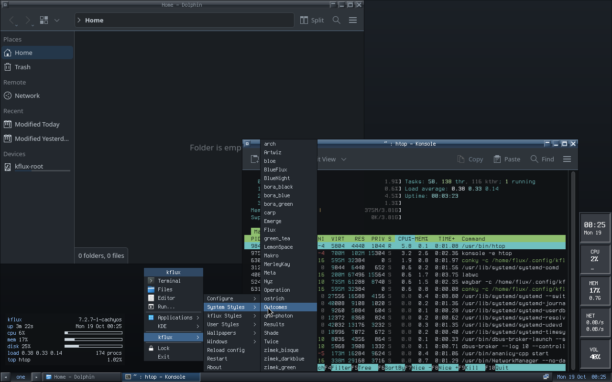
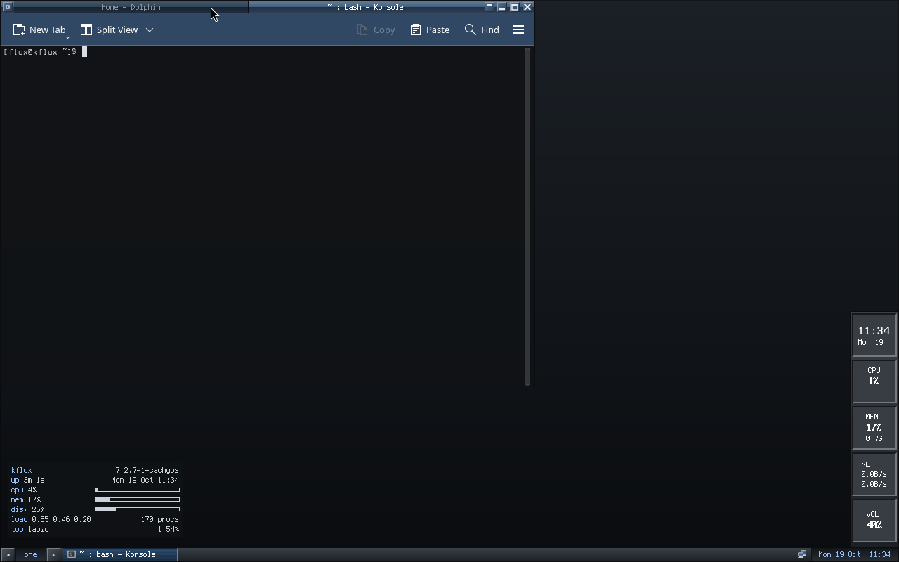
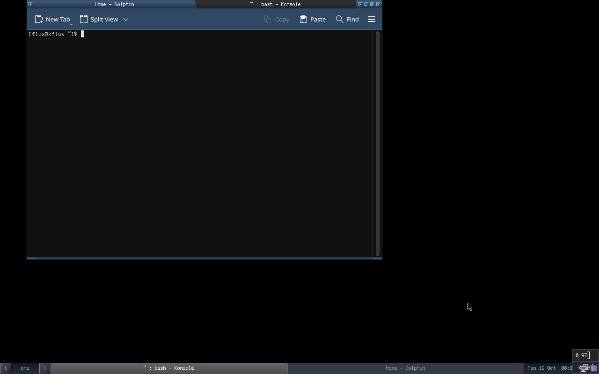

# kflux

Fluxbox's simplicity and text-file configurability, on a modern Wayland
compositor ([labwc](https://labwc.github.io)), with KDE's apps and services
behind it. This is a proof of concept built on CachyOS that boots in QEMU.

- Research: [research/fluxbox-research.md](research/fluxbox-research.md)
- Decision: [decisions/0001-labwc-base-with-kde-behind-it.md](decisions/0001-labwc-base-with-kde-behind-it.md)



*Default `kflux-Carbon` style. The root menu (from `~/.config/kflux/menu`)
is open on kflux → System Styles, listing Fluxbox's 27 shipped styles. Around
it: Dolphin, a translucent Terminus Konsole running htop, conky stats, the
dockapp slit and the toolbar. Same session in Fluxbox's own styles:
[Artwiz](screenshots/kflux-poc-artwiz.png),
[MerleyKay](screenshots/kflux-poc-merleykay.png) and
[bloe](screenshots/style-bloe.png), which uses its original XPM buttons.
KDE's network settings running on labwc: [kde-settings](screenshots/kde-settings.png).*



*Fluxbox-style tabs on labwc: Konsole Ctrl-dragged onto Dolphin's titlebar.
Click a tab or press Super+Tab to switch. Super+G tabs in the window
underneath, and Super+Shift+G takes a tab out again. See
[docs/USAGE.md](docs/USAGE.md#tabs) and
[decisions/0004](decisions/0004-tabs-in-labwc.md).*

## Install on CachyOS or Arch

kflux isn't in the AUR yet. You can build its two packages from this repo:
`labwc-kflux` (labwc 0.20.2 plus the tabs patch; it replaces `labwc`) and
`kflux`.

```bash
git clone https://github.com/endthestart/kflux
cd kflux/packaging/arch/labwc-kflux && makepkg -si
cd ../kflux && makepkg -si
```

Then log out and pick **kflux** at your display manager's session list.
`kflux doctor` checks the setup.

## Status (2026-10-19)

The image boots under QEMU TCG on an M2 Max in about 20 s and lands in the
configured desktop. `build/verify.sh` passes 28 of 28 checks on a fresh boot:

- the session: toolbar, slit, wallpaper, mako, conky, and no translation warnings
- labwc-kflux (labwc with tabs) installed and the tab bindings translated
- KDE: colour scheme, polkit agent, KDE Connect, NetworkManager, PipeWire, and the KDE and wlr portals
- these apps start and stay up: Dolphin, Konsole, Kate, KRunner, and System Settings' audio, network and colours modules

Decided for 1.0 ([decisions/0003](decisions/0003-1.0-is-kflux-on-labwc.md)): kflux on labwc is the desktop, with Fluxbox tabs added to labwc by a patch ([decisions/0004](decisions/0004-tabs-in-labwc.md)). An experimental second session, **fluxland (kflux)**, is parked and not part of 1.0. See
[Second session: fluxland](#second-session-fluxland-tabs) below.

Known gaps in the kflux session (see the [decision record](decisions/0001-labwc-base-with-kde-behind-it.md)):

- No keymodes or chained keys, no toolbar auto-hide. Tabs come from labwc-kflux, labwc plus kflux's tabs patch ([decisions/0004](decisions/0004-tabs-in-labwc.md)).
- The iconbar lists windows from every workspace, because Wayland's foreign-toplevel protocol carries no workspace.
- labwc titlebars approximate bevelled and diagonal styles (Results, Outcomes, Nyz). The toolbar renders them faithfully.
- conky runs on Xwayland. conky 1.25.2's Wayland backend aborts with a `set_font` assertion in `display-wayland.cc`.
- Display settings use wdisplays, because KScreen needs KWin.

## What you get

You configure kflux the Fluxbox way: a few short files in `~/.config/kflux/`,
in Fluxbox's own syntax.

| File | Fluxbox equivalent | Becomes |
|---|---|---|
| `init` | `~/.fluxbox/init` | labwc `rc.xml` (workspaces, focus, placement, titlebar), Waybar toolbar and slit |
| `keys` | `~/.fluxbox/keys` | labwc keyboard and mouse bindings |
| `apps` | `~/.fluxbox/apps` | labwc window rules, plus `[startup]` programs |
| `menu` | `~/.fluxbox/menu` | the root menu (right-click the desktop) |
| `windowmenu` | `~/.fluxbox/windowmenu` | the titlebar right-click menu |
| `slitlist` | `~/.fluxbox/slitlist` | the dockapp tiles in the slit |
| `startup` | `~/.fluxbox/startup` | commands run at login |

Any Fluxbox style works unmodified. Pick one from root menu → kflux → System
Styles. Each style is rendered into:

- the labwc window theme, with Fluxbox-style bevelled buttons, or the style's own XPM buttons where it has them
- Waybar CSS for the toolbar and slit
- a KDE colour scheme, so Dolphin and Konsole recolour live
- the mako notification colours
- the swaylock colours
- the wallpaper

After editing a file, choose **Reload config** from the menu, or run
`kflux reconfigure`. `kflux warnings` lists anything that could not be
translated, such as tabs, keymodes or chained keys.

Behind it you get these KDE pieces:

- Konsole, Dolphin and Kate
- KRunner (Alt+F2, as fbrun was)
- System Settings and its standalone modules
- KDE Connect
- the KDE file dialogs, polkit agent, KWallet and Breeze

A full Plasma session is also installed as a fallback; pick it at the login
screen after logging out.

## Second session: fluxland (tabs)



*Konsole Ctrl-dragged onto Dolphin's titlebar: one frame, two tabs, in
`kflux-Carbon`. Also: [the other tab](screenshots/fluxland-tabs-dolphin.png),
[the System Styles menu](screenshots/fluxland-menu-styles.png),
[bloe](screenshots/fluxland-style-bloe.png) and
[the login screen's session list](screenshots/fluxland-tuigreet.png).*

[fluxland](https://github.com/ecliptik/fluxland) is a Fluxbox clone written
as a Wayland compositor. kflux ports it to wlroots 0.20 and installs it as a
second session. To try it, log out (root menu → Exit), press F3 at the login
screen, pick **fluxland (kflux)**, and log in as flux/flux.

It reads the same `~/.config/kflux` files. At each login,
`fluxland-kflux-session` regenerates `~/.config/fluxland` from them, so edit
the kflux files, not the copies. It also adds the Fluxbox default bindings
that the kflux keys file leaves out:

- Ctrl-drag a titlebar onto another window's titlebar to tab it
- click a tab, or press Mod4+Tab / Mod4+Shift+Tab, to switch tabs

Styles from the root menu apply to fluxland only. `kflux style` changes KDE's
colours too.

What it lacks compared with the kflux session:

- no Applications pipe menu
- the slit holds Wayland windows (two small foot dockapps), not Waybar tiles
- no conky
- titlebar button layout from init is ignored

Findings, and whether it should replace labwc, are in
[the decision record](decisions/0001-labwc-base-with-kde-behind-it.md#phase-2-fluxland-as-a-second-session-2026-10-19).

## Build and run (macOS, Apple Silicon)

Requirements: Homebrew `colima`, `docker` and `qemu`.

```bash
build/build.sh
```

The build runs on its own Colima profile, `kflux` (4 vCPU, 4 GiB). It assembles
an x86_64 CachyOS rootfs in the `cachyos/cachyos` container with pacstrap.
It builds the fluxland package with makepkg from
`packaging/arch/fluxland-kflux/PKGBUILD`, fed `third_party/fluxland` and the
port patch, and caches the package by input hash. It then writes a GPT/UEFI disk (systemd-boot, ext4 root) without loop
devices and converts it to `vm/kflux.qcow2`. The package list is
[build/packages.txt](build/packages.txt). The Colima profile stops when the
build finishes.

```bash
build/run-vm.sh
```

This boots the image under QEMU TCG emulation (4 vCPU, 4 GiB, 1280×800) in a
window. Add `--headless` for VNC on `127.0.0.1:5921` instead.

```bash
build/screenshot.sh
```

This saves a PNG of the VM screen to `screenshots/`.

```bash
ssh -i .cache/ssh/id_ed25519 -p 2232 flux@127.0.0.1
```

This opens a shell in the VM.

The VM logs in automatically as `flux`. The password is `flux`, for sudo and
for the login screen after logout. These are proof-of-concept credentials.

Dev loop, against the running VM:

- `build/push-dev.sh [--reset]` copies `overlay/usr` in and runs `kflux reconfigure`.
- `build/vm-ssh.sh --wl CMD` runs CMD inside the Wayland session's environment.
- `build/vm-input.py click X Y right` and `keys ctrl alt right` send pointer and keyboard input over QMP.
- `build/preview.sh STYLE` gives a quick headless render of labwc and Waybar in the builder container.
- `build/vm-input.py drag X1 Y1 X2 Y2 ctrl` sends a modifier drag, such as the Ctrl-drag that tabs windows.
- `build/fluxland-dev-push.sh` rebuilds fluxland in a `kflux-fluxland-dev` container and installs it into the running VM. Apply the patch to `third_party/fluxland` first; the script's header has the steps.
- `build/fluxland-uitests.sh` runs fluxland's own pytest UI suite inside the VM, against a nested headless fluxland.

On a Linux host with `/dev/kvm`, `build/run-vm.sh` uses KVM and runs the image
at native speed. Elsewhere it falls back to QEMU's software emulation (TCG).
Build and test use open-source tools only: QEMU, OVMF and pacstrap.

## Layout

```
build/       build.sh (host), container/ (in-container image build),
             run-vm.sh, screenshot.sh, packages.txt
overlay/     files copied into the image
  usr/bin/kflux            the translator and session helper (Python, stdlib only)
  usr/bin/kflux-session    session entry: environment for KDE apps, then labwc
  usr/bin/fluxland-kflux-session  second session: kflux files -> ~/.config/fluxland, then fluxland
  usr/lib/kflux/session-env       environment shared by both sessions
  usr/share/kflux/skel/    default init, keys, apps, menu, windowmenu, slitlist, startup
  etc/greetd/              autologin; tuigreet after logout
third_party/ fluxland/ (upstream checkout, pinned at 32d1009, unmodified),
             patches/fluxland-wlroots-0.20.patch (the port),
             patches/labwc-tabs.patch (Fluxbox tabs for labwc 0.20.2, GPL-2.0-only)
packaging/   arch/*/PKGBUILD: kflux and labwc-kflux (1.0); fluxland-kflux (parked; the image build still uses it)
research/    findings and raw reports with sources
decisions/   decision records
screenshots/ captures of the running PoC
vm/          disk image and firmware vars (not tracked)
.cache/      build log, SSH key, extracted docs (not tracked)
```

## Credits and licences

- **kflux** (this repo: the `kflux` translator, session files, the
  `kflux-Carbon` style and the build scripts): MIT.
- **Fluxbox** default `keys`, `menu` and `windowmenu` formats and defaults:
  MIT, © the Fluxbox team. kflux's `skel/keys` is derived from Fluxbox
  1.3.7's `data/keys`.
- **Fluxbox styles** are used unmodified from CachyOS's `fluxbox` package
  (`/usr/share/fluxbox/styles`) and converted on the user's machine. Fluxbox's
  code is MIT. The styles by tenner (Sven Michel, tenr.de) carry CC BY-SA 3.0
  notices: arch, bloe, bora_*, carp, green_tea, ostrich and zimek_*. The others
  credit their authors in their headers: skypher, Pax, mack@incise.org,
  joel carlbark, ikaro, BioNiK, xlife and the Fluxbox team. See
  [research/raw/02-fluxbox-culture.md](research/raw/02-fluxbox-culture.md).
- **fluxland** (`third_party/fluxland`, installed as `fluxland-kflux`): MIT,
  © 2025 fluxland contributors (ecliptik/fluxland). kflux's port patch in
  `third_party/patches/` is MIT too.
- **labwc tabs patch** (`third_party/patches/labwc-tabs.patch`, installed as
  `labwc-kflux`): a modification of labwc, so GPL-2.0-only like labwc.
- **Fonts:** Terminus (SIL OFL, Dimitar Zhekov), via `ttf-terminus-nerd`;
  DejaVu (Bitstream Vera licence); Noto (OFL).
- **Upstream components** come from distro packages under their own licences:
  - labwc (GPL-2.0)
  - Waybar (MIT)
  - KDE Plasma, Frameworks and apps (GPL/LGPL)
  - mako, swaybg and swaylock (MIT)
  - CachyOS packages and kernel
- Screenshots and links in `research/` are for research only and are not shipped.
- kflux was written with Claude (Anthropic) under the maintainer's direction and review.
