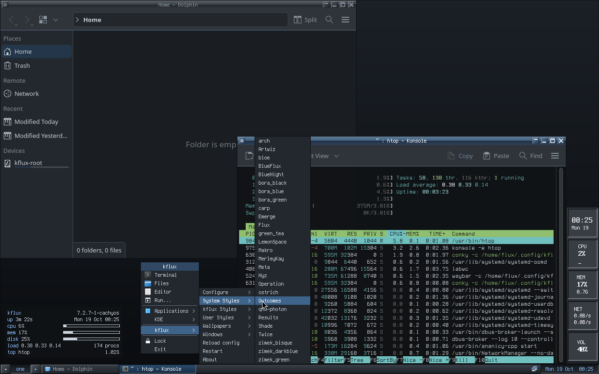
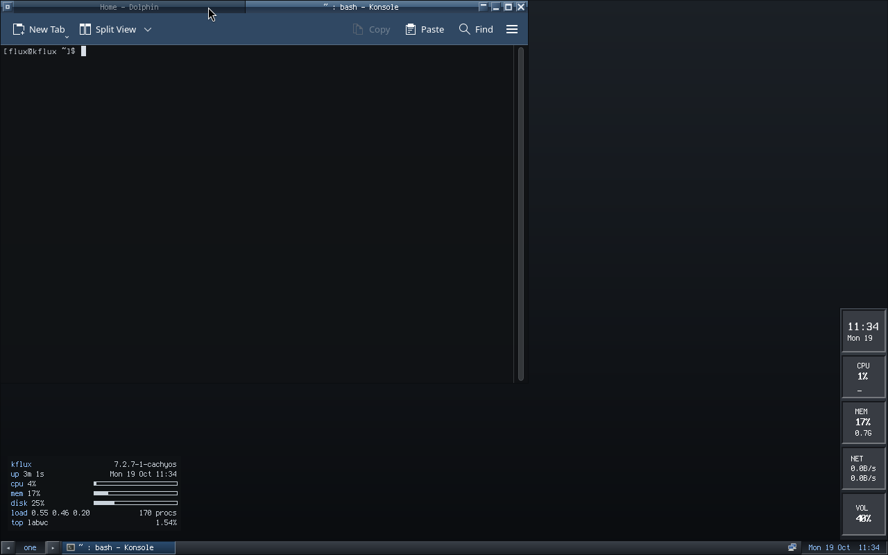

# kflux

A Fluxbox-style desktop for Wayland. Your whole desktop lives in a few short
text files in Fluxbox's own formats, and any Fluxbox style works unmodified.
Underneath it's [labwc](https://labwc.github.io) and Waybar, with KDE's apps
and services behind it.



*More styles: [Artwiz](docs/images/style-artwiz.png),
[MerleyKay](docs/images/style-merleykay.png), [bloe](docs/images/style-bloe.png).
KDE's network settings on kflux: [kde-settings](docs/images/kde-settings.png).*

## Install

kflux supports Arch Linux and CachyOS. From the AUR:

```bash
yay -S kflux
```

Then log out and pick **kflux** in your display manager's session list. On
first login kflux seeds `~/.config/kflux/` with defaults; `kflux doctor`
checks the setup.

Optional: `labwc-kflux` adds Fluxbox-style window tabs. It's labwc plus one
patch and replaces the `labwc` package.

```bash
yay -S labwc-kflux
```

Optional dependencies (KDE apps, the classic Fluxbox styles, conky and so on)
are listed by `pacman -Qi kflux`.

## How it works

You configure kflux the Fluxbox way, in `~/.config/kflux/`:

| File | Fluxbox equivalent | Becomes |
|---|---|---|
| `init` | `~/.fluxbox/init` | labwc `rc.xml` (workspaces, focus, placement, titlebar), the Waybar toolbar and slit |
| `keys` | `~/.fluxbox/keys` | labwc keyboard and mouse bindings |
| `apps` | `~/.fluxbox/apps` | labwc window rules and startup programs |
| `menu` | `~/.fluxbox/menu` | the root menu (right-click the desktop) |
| `windowmenu` | `~/.fluxbox/windowmenu` | the titlebar right-click menu |
| `slitlist` | `~/.fluxbox/slitlist` | the dockapp tiles in the slit |
| `startup` | `~/.fluxbox/startup` | commands run at login |

Pick a style from root menu → kflux → System Styles. Each style is rendered
into the window theme, the toolbar and slit, a KDE colour scheme (Dolphin and
Konsole recolour live), the notification and lock-screen colours, and the
wallpaper.

After editing a file, choose **Reload config** from the menu or run
`kflux reconfigure`. `kflux warnings` lists anything that couldn't be
translated.

Behind it: Konsole, Dolphin and Kate; KRunner on Alt+F2; System Settings'
standalone modules; KDE Connect; the KDE file dialogs, polkit agent and
Breeze.



*Tabs with `labwc-kflux`: Ctrl-drag a titlebar onto another window's. Click a
tab or press Super+Tab to switch.*

## Known gaps

- No keymodes, chained keys or toolbar auto-hide yet.
- The iconbar lists windows from every workspace: Wayland's foreign-toplevel
  protocol carries no workspace.
- labwc titlebars approximate bevelled and diagonal gradients. The toolbar
  renders them faithfully.
- Display settings use wdisplays, because KScreen needs KWin.

## Documentation

- [User guide](docs/USAGE.md)
- [Changelog](CHANGELOG.md)
- [Design decisions](docs/adr/)
- [Building and testing](docs/DEVELOPMENT.md)
- [Contributing](CONTRIBUTING.md), [security](SECURITY.md), [code of conduct](CODE_OF_CONDUCT.md)

## Licence

kflux is MIT ([LICENSE](LICENSE)). The labwc tabs patch is GPL-2.0-only, like
labwc. Fluxbox-derived defaults keep Fluxbox's MIT notice. Details and
credits: [NOTICE.md](NOTICE.md).
