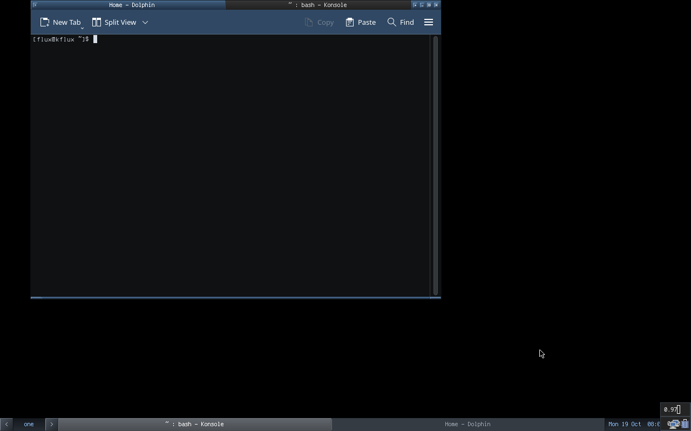

# fluxland (kflux): parked

Not part of any kflux release ([ADR 0004](../../docs/adr/0004-fluxland-parked.md)).
This directory holds everything needed to build and test it, so it can move to
a repository of its own.

[fluxland](https://github.com/ecliptik/fluxland) is an MIT-licensed Fluxbox
clone written as a Wayland compositor. This port runs it on wlroots 0.20 as a
second session, **fluxland (kflux)**, that reads the same `~/.config/kflux`
files as kflux.



| File | What it is |
|---|---|
| `fluxland-wlroots-0.20.patch` | the port of upstream commit `32d1009` (fluxland 1.1.0) to wlroots 0.20; its header lists every change |
| `PKGBUILD` | `fluxland-kflux`: fluxland at the pinned commit, patched, plus the session |
| `fluxland-kflux-session`, `fluxland-kflux.desktop` | the session: regenerates `~/.config/fluxland` from `~/.config/kflux` at each login, then starts fluxland |
| `dev-push.sh` | rebuilds fluxland in a container and installs it into the running VM |
| `uitests.sh` | runs fluxland's pytest UI suite inside the VM against a nested headless fluxland |
| `screenshots/` | the session in the test VM |
| `upstream/` | a local clone of ecliptik/fluxland (not tracked) |

## Build and try it

```bash
git clone https://github.com/ecliptik/fluxland experimental/fluxland/upstream
git -C experimental/fluxland/upstream checkout 32d1009
tools/build.sh --with-fluxland
tools/run-vm.sh
```

Log out (root menu → Exit), press F3 at the login screen, pick
**fluxland (kflux)**, and log in as flux/flux.

## What the port found

- Six wlroots 0.19/0.20 API changes broke the build. Two behaviour changes
  compiled cleanly and aborted at runtime: a configure sent before a
  toplevel's first commit (crashed on the first window), and listeners left on
  a destroyed global (crashed on every exit).
- fluxland's own bugs, also fixed in the patch: drag-to-tab only worked when
  the target was stacked above; a dropped tab kept keyboard focus;
  `toolbar.tools` ignored commas; dockapps showed in the icon bar.
- Its C unit tests stub wlroots and didn't catch any of this. The UI suite in
  the VM went from 82 passed / 73 failed to 155 passed / 0 failed.

Compared with kflux on labwc it lacks pipe menus (no Applications menu), conky
and the Waybar slit tiles; it ignores `titlebar.left`/`right`, and styles
picked from its menu change only fluxland.
